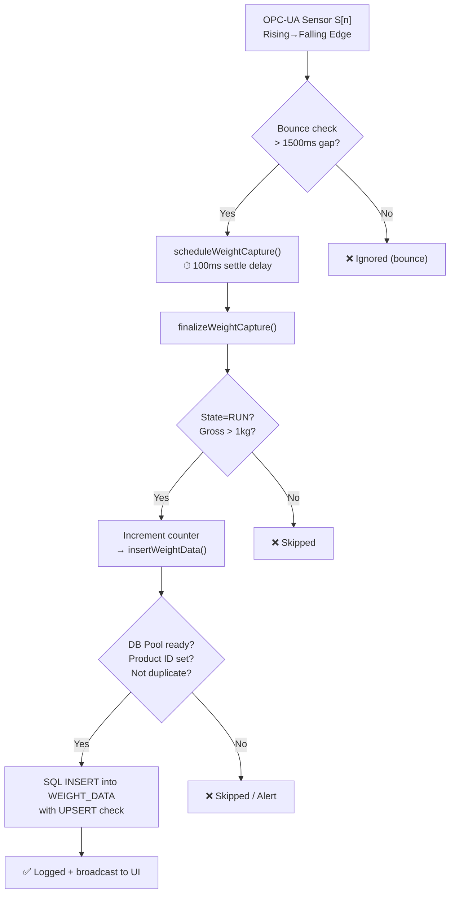

# SCADA App

Aplikasi SCADA (Supervisory Control and Data Acquisition) untuk monitoring dan kontrol sistem weighing carousel industri. Aplikasi ini menggunakan Node.js sebagai backend, dengan integrasi OPC UA untuk komunikasi real-time dengan perangkat industri, dan database MSSQL/PostgreSQL untuk penyimpanan data.

## Fitur Utama

- **Real-time Monitoring**: Dashboard real-time untuk monitoring berat carousel menggunakan Socket.io
- **Autentikasi Pengguna**: Sistem login dengan JWT dan role-based access
- **OPC UA Integration**: Komunikasi dengan server OPC UA untuk data industri
- **Database Integration**: Dukungan MSSQL dan PostgreSQL
- **Data Aggregation**: Agregasi data otomatis dengan cron jobs
- **Dashboard Offline Ready**: Dashboard menampilkan status OFFLINE dan 0.00 Kg secara otomatis saat data belum tersedia atau koneksi terputus.
- **Persistent Counter Logic**: Counter (Product Count) tetap tersimpan berdasarkan PACKING_ORDER. Saat aplikasi mulai, counter akan mengambil nilai terakhir dari history. Jika PACKING_ORDER baru masuk tanpa record di WEIGHT_DATA, counter otomatis di-reset ke 0 dengan logging perubahan.
- **Smart Reset Counter**: Counter otomatis reset ke 0 dalam dua skenario: (1) saat status diganti ke STOP dan target produksi sudah tercapai, atau (2) ketika PACKING_ORDER baru terdeteksi tanpa history di database.
- **Windows Operational Scripts**: Script batch (.bat) untuk mempermudah instalasi dan menjalankan aplikasi di Windows dengan satu klik.
- **PKI Certificates**: Manajemen sertifikat untuk keamanan OPC UA

## Data Flow — Weight Data Insertion into SQL

Berikut adalah diagram alur proses penyisipan data berat dari sensor OPC-UA hingga tersimpan di database SQL:



### Penjelasan Alur

1. **Trigger**: Sensor OPC-UA (`S1`–`S5`) mendeteksi produk melewati sensor (falling edge `true → false`).
2. **Bounce Protection**: Abaikan jika jeda dari edge sebelumnya < 1500ms (mencegah double-trigger).
3. **Settle Delay**: Timer 100ms menunggu berat timbangan stabil.
4. **Validasi**: Pastikan carousel dalam状态 `RUN` dan gross weight > 1 kg (filter noise).
5. **Counter Increment**: Counter lokal dinaikkan, dengan flag `_localCounterIs1Based` untuk konvensi 1-based.
6. **Insert**: Query `IF NOT EXISTS` mencegah duplikasi; data dicatat dengan timezone WIB (UTC+7).
7. **Hasil**: Berhasil → log + broadcast ke dashboard via WebSocket. Gagal → alert ke UI (debounce 8s).

## Prerequisites

Sebelum menjalankan aplikasi ini, pastikan Anda memiliki:

- **Node.js** versi 18 atau lebih tinggi
- **npm** (biasanya sudah terinstall dengan Node.js)
- **Database Server**:
  - Microsoft SQL Server (untuk data weighing)
  - PostgreSQL (untuk autentikasi dan user management)
- **OPC UA Server** (misalnya KEPServerEX) yang terhubung ke perangkat weighing
- **Git** untuk cloning repository

### Untuk Linux

- Pastikan Node.js terinstall:
  ```bash
  node --version
  npm --version
  ```
- Jika belum, install menggunakan package manager:
  ```bash
  # Ubuntu/Debian
  sudo apt update
  sudo apt install nodejs npm

  # CentOS/RHEL
  sudo yum install nodejs npm
  ```

### Untuk Windows

- Download dan install Node.js dari [nodejs.org](https://nodejs.org/)
- Pastikan Node.js dan npm terinstall dengan membuka Command Prompt dan menjalankan:
  ```cmd
  node --version
  npm --version
  ```

## Instalasi

### Langkah 1: Clone Repository

#### Linux
```bash
git clone https://github.com/your-username/scada-app.git
cd scada-app
```

#### Windows
```cmd
git clone https://github.com/your-username/scada-app.git
cd scada-app
```

### Langkah 2: Install Dependencies

#### Linux
```bash
npm install
```

#### Windows
```cmd
npm install
```

### Langkah 3: Setup Database

#### PostgreSQL Setup (untuk autentikasi login aplikasi scada-app - postgreSQL)

**Linux:**
```bash
# Install PostgreSQL jika belum ada
sudo apt install postgresql postgresql-contrib  # Ubuntu/Debian
# atau
sudo yum install postgresql-server postgresql-contrib  # CentOS/RHEL

# Start PostgreSQL service
sudo systemctl start postgresql
sudo systemctl enable postgresql

# Buat database dan user
sudo -u postgres psql
CREATE DATABASE scada_db;
CREATE USER scada_user WITH PASSWORD 'secure_password';
GRANT ALL PRIVILEGES ON DATABASE scada_db TO scada_user;
\q
```

**Windows:**
- Download dan install PostgreSQL dari [postgresql.org](https://www.postgresql.org/download/windows/)
- Buka pgAdmin atau psql
- Buat database `scada_db` dan user `scada_user` dengan password `secure_password`

#### MSSQL Setup (untuk data weighing)

- Pastikan Microsoft SQL Server terinstall dan berjalan
- Server remote sudah dikonfigurasi (dalam contoh: columba.s-net.id)
- Database `WEIGHING` sudah ada dengan tabel yang diperlukan

### Langkah 4: Konfigurasi Aplikasi

#### Edit File Konfigurasi

1. **Database PostgreSQL** (`config/db.config.js`):
   ```javascript
   module.exports = {
       HOST: "localhost",  // atau IP server PostgreSQL
       USER: "scada_user", // "scada_user" adalah username aplikasi bukan untuk login page
       PASSWORD: "secure_password", // "secure_password" adalah password yang dipakai oleh aplikasi ini untuk membuka akses ke login page
       DB: "scada_db",
       dialect: "postgres",
       // ... konfigurasi pool
   };
   ```

2. **Database MSSQL** (`config/db.config.mssql.js` dan `config/db.config.weighing.js`):
   - File config ini sekarang **dinamis** dan membaca nilai SQL dari:
     1. Environment variable (`MSSQL_USER`, `MSSQL_PASSWORD`, `MSSQL_SERVER`, `MSSQL_DATABASE`, `MSSQL_PORT`)
     2. `config/scada-settings.json`
     3. Fallback default internal
   - Artinya, jika Anda update SQL Server dari menu Settings di aplikasi (Windows UI), koneksi SQL backend akan mengikuti nilai terbaru tersebut.

3. **OPC UA Configuration** (`config/opcua.config.json`):
   ```json
   {
       "endpointUrl": "opc.tcp://your-IPServer:49320",
       "securityMode": "Sign",
       "securityPolicy": "Basic256",
       "username": "OPCusername", // Ganti dengan username OPC server anda
       "password": "OPCpassword", // Ganti dengan password OPC server anda
       // ... nodes configuration
   }
   ```

4. **SCADA Settings** (`config/scada-settings.json`):
   ```json
   {
       "sql_server": "yourSQLserverIP",
       "sql_uid": "yourSQLUsername",
       "sql_pass": "yourSQLpassword",
       "sql_db": "yourDatabaseName",
       // ... tabel dan interlocks
   }
   ```
   - Nilai `sql_server`, `sql_uid`, `sql_pass`, dan `sql_db` adalah sumber utama konfigurasi SQL yang dipakai runtime SCADA.

#### Setup Environment Variables (opsional)

Buat file `.env` di root directory:
```
NODE_ENV=development
PORT=3001
JWT_SECRET=your_jwt_secret_key
SCADA_AUTO_SEED_ADMIN=true
SCADA_DEFAULT_ADMIN_USER=admin
SCADA_DEFAULT_ADMIN_PASSWORD=12345678
SCADA_DEFAULT_ADMIN_EMAIL=admin@scada.local
MSSQL_USER=optional_override_user
MSSQL_PASSWORD=optional_override_password
MSSQL_SERVER=optional_override_server
MSSQL_DATABASE=optional_override_database
MSSQL_PORT=1433
```

Keterangan tambahan akun default:
- Saat startup, aplikasi akan otomatis membuat admin default **hanya jika** tabel user masih kosong.
- Default dapat diubah lewat `SCADA_DEFAULT_ADMIN_USER`, `SCADA_DEFAULT_ADMIN_PASSWORD`, dan `SCADA_DEFAULT_ADMIN_EMAIL`.
- Nonaktifkan auto-seed dengan `SCADA_AUTO_SEED_ADMIN=false`.
- **Khusus production (`NODE_ENV=production`)**: jika auto-seed aktif dan password masih `12345678`, aplikasi akan menolak startup (exit) demi keamanan.


## Menjalankan Aplikasi

Aplikasi akan berjalan di `http://localhost:3001`

### 🪟 Windows — One-Click Deployment (Rekomendasi)

Untuk pengguna Windows, jalankan script berikut sebagai **Administrator**:

```
deploy_windows.bat
```

Script ini akan melakukan **SEMUA** langkah secara otomatis:
1. ✅ Cek Node.js
2. ✅ Install PM2
3. ✅ Setup database PostgreSQL (scada_db, user scada_user)
4. ✅ Generate file `.env` dengan konfigurasi lengkap
5. ✅ Install semua dependencies (`npm install`)
6. ✅ Seed admin user
7. ✅ Start aplikasi dengan PM2
8. ✅ Setup auto-start saat Windows logon

Setelah selesai, buka `http://localhost:3001` dan login dengan:
- **Username:** `admin`
- **Password:** `12345678`

### Startup manual (via linux terminal)

Untuk menjalankan aplikasi di server secara manual bisa menggunakan langkah berikut:

1. Masuk ke direktori path aplikasi
2. Ketik: npm start

### Production Mode (Linux Server)

Sebelum menjalankan di production, pastikan salah satu kondisi ini terpenuhi:
- `SCADA_DEFAULT_ADMIN_PASSWORD` sudah diganti ke password kuat.
- atau `SCADA_AUTO_SEED_ADMIN=false` (jika provisioning user dilakukan manual).

Untuk menjalankan aplikasi di server agar tetap berjalan di background, gunakan **PM2**:

```bash
# Install PM2 jika belum ada
sudo npm install -g pm2

# Jalankan aplikasi
pm2 start index.js --name scada-app

# Perintah umum PM2
pm2 status                # Cek status aplikasi
pm2 logs scada-app        # Lihat log real-time
pm2 restart scada-app     # Merestart aplikasi
pm2 stop scada-app        # Menghentikan aplikasi
pm2 save                  # Simpan daftar aplikasi agar auto-start saat reboot
```

## Penggunaan

1. **Akses Dashboard**:
   - Buka browser dan navigasi ke `http://localhost:3001`
   - Login dengan kredensial yang valid
   - Untuk instalasi baru (database user kosong), akun awal bisa dibuat otomatis dari env:
     - `SCADA_DEFAULT_ADMIN_USER` (default: `admin`)
     - `SCADA_DEFAULT_ADMIN_PASSWORD` (default dev: `12345678`)
   - Di production, gunakan password kuat (jangan gunakan `12345678`).

2. **Monitoring Real-time**:
   - Dashboard akan menampilkan berat carousel secara real-time
   - Data diperbarui melalui WebSocket connection

3. **OPC UA Connection**:
   - Aplikasi akan otomatis connect ke OPC UA server
   - Monitor status connection di logs

4. **Download Certificates**:
   - Untuk trust dengan OPC UA server, download certificate dari:
     `http://localhost:3001/download/client-cert?format=pem` atau `der`

## API Endpoints

### Authentication
- `POST /api/auth/signup` - Registrasi user baru
- `POST /api/auth/signin` - Login

### SCADA Data
- `GET /api/scada/status` - Status koneksi SQL
- `GET /api/scada/history` - Riwayat berat
- `GET /api/scada/alarms/active` - Alarm aktif
- `GET /api/scada/history/:tag` - Riwayat tag spesifik
- `POST /api/control` - Kontrol carousel (Run, Pause, Stop, Reset)
  - *Catatan*: Counter akan reset otomatis dalam dua kasus: (1) jika command STOP dikirim saat counter >= target, atau (2) ketika PACKING_ORDER baru terdeteksi tanpa history di WEIGHT_DATA.

### OPC UA
- `GET /api/opcua/status` - Status koneksi OPC UA
- `POST /api/opcua/connect` - Connect ke OPC UA server
- `POST /api/opcua/disconnect` - Disconnect dari OPC UA server
- `GET /api/opcua/config` - Ambil konfigurasi OPC UA (admin)
- `PUT /api/opcua/config` - Update konfigurasi OPC UA (admin)
- `POST /api/opcua/browse` - Browse OPC UA nodes (admin)

### Settings
- `GET /api/settings` - Pengaturan aplikasi

## Troubleshooting

### Masalah Umum

1. **Database Connection Error**:
   - Pastikan database server berjalan
   - Periksa kredensial di `config/scada-settings.json` atau di menu Settings aplikasi
   - Jika menggunakan environment variable, pastikan nilainya benar (karena env override nilai file settings)
   - Untuk remote MSSQL, pastikan firewall mengizinkan koneksi

2. **Error Login (column "mustChangePassword" does not exist)**:
   - Error ini terjadi setelah adanya penambahan fitur keamanan baru, sedangkan skema database (tabel `users`) pada PostgreSQL belum memiliki kolom tersebut.
   - Karena mode produksi menggunakan `sync({ force: false })`, skema tidak akan otomatis diubah.
   - **Solusi**: Matikan aplikasi yang sedang berjalan, kemudian jalankan script sinkronisasi berikut:
     ```bash
     sudo node update_db.js
     ```
   - Setelah selesai dan berhasil, jalankan kembali aplikasinya (misal menggunakan `sudo nohup npm start > scada.log 2>&1 &`).

3. **RESET Button Error**:
   - Jika tombol RESET di footer error dengan pesan `Cannot create property 'dataType' on number '1'`, pastikan backend menggunakan update terbaru di `utils/opcua.manager.js` yang menangani konversi tipe data ke `Variant` dengan benar.

4. **OPC UA Certificate Issue**:
   - Periksa endpoint URL dan kredensial
   - Pastikan OPC UA server berjalan
   - Download dan install client certificate ke server OPC UA

5. **Library Compatibility Issue (Linux → Windows)**:
   - Terdapat isu kompatibilitas library saat deploy dari Linux ke Windows:
   - **`hexy` v0.4.0** adalah ES Module (`"type": "module"`), tidak bisa di-`require()` oleh `node-opcua-debug` (CommonJS).
   - **Solusi**: Pastikan `hexy` di-pin ke v0.3.0 dengan menambahkan `overrides` di `package.json`:
     ```json
     "overrides": {
         "hexy": "0.3.0"
     }
     ```
   - **`bcrypt`** memiliki native binding (C++) yang butuh **Visual Studio Build Tools** + **Python** + **node-gyp** untuk kompilasi di Windows.
   - **Solusi alternatif**: Ganti `bcrypt` dengan `bcryptjs` (pure JavaScript, tanpa kompilasi) — API-nya identik, tinggal mengganti `require("bcrypt")` menjadi `require("bcryptjs")`.
   - **`node-opcua`** secara umum cross-platform, tapi beberapa sub-dependensi (seperti `@ster5/global-mutex`) mungkin memerlukan compiled binary. Disarankan test terlebih dahulu di lingkungan Windows.

6. **Port Already in Use**:
   - Ubah PORT di environment atau file konfigurasi
   - Kill process yang menggunakan port:
     ```bash
     # Linux
     sudo lsof -i :3001
     sudo kill -9 <PID>
     
     # Windows
     netstat -ano | findstr :3001
     taskkill /PID <PID> /F
     ```

6. **Node Modules Issues**:
   - Hapus `node_modules` dan `package-lock.json`
   - Jalankan `npm install` ulang

### Logs

- Logs aplikasi akan muncul di terminal/console
- Untuk logging lebih detail, set `NODE_ENV=development`

## Kontribusi

1. Fork repository
2. Buat branch fitur baru (`git checkout -b feature/AmazingFeature`)
3. Commit perubahan (`git commit -m 'Add some AmazingFeature'`)
4. Push ke branch (`git push origin feature/AmazingFeature`)
5. Buat Pull Request

## Lisensi

Distributed under the ISC License. See `LICENSE` for more information.

## Kontak

- Project Link: [https://github.com/myiotserver/scada-app](https://github.com/your-username/scada-app)
